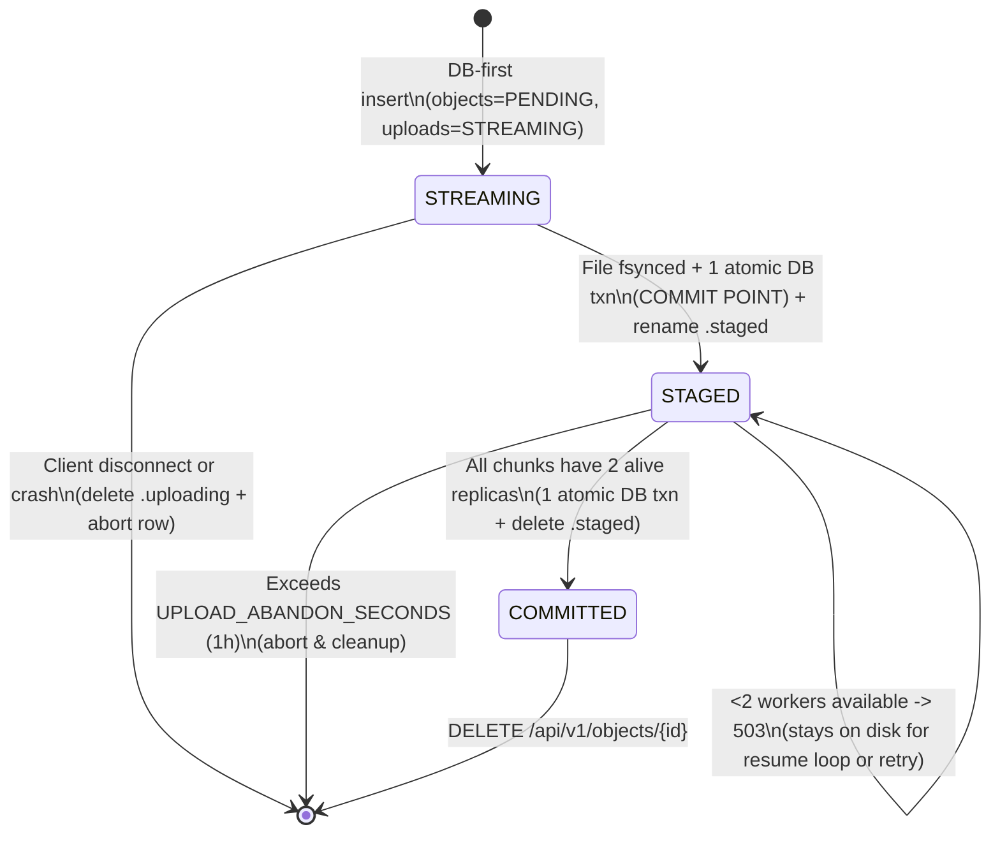

# Mini Distributed Cloud Object Store — Complete Technical Deep Dive

This document explains **every part of your project in detail** — architecture, codebase structure, database schema, crash-safe upload staging, idempotency, LRU caching, fault tolerance, data integrity, APIs, Docker deployment, testing, and common viva/interview questions.

---

## Table of Contents

1. [Big Picture & Mental Model](#1-big-picture--mental-model)
2. [Codebase Map (File-by-File Guide)](#2-codebase-map-file-by-file-guide)
3. [Database Schema & State Machines](#3-database-schema--state-machines)
4. [End-to-End Request Flows](#4-end-to-end-request-flows)
5. [Fault Tolerance, Heartbeats & Self-Healing](#5-fault-tolerance-heartbeats--self-healing)
6. [Data Integrity & Atomic Disk Storage](#6-data-integrity--atomic-disk-storage)
7. [Bounded LRU Caching & Stale-Fill Protection](#7-bounded-lru-caching--stale-fill-protection)
8. [Complete API Reference](#8-complete-api-reference)
9. [Docker Deployment & Configuration Reference](#9-docker-deployment--configuration-reference)
10. [Web Dashboard, Automated Tests & Demo Guide](#10-web-dashboard-automated-tests--demo-guide)
11. [Viva & Presentation Q&A Cheat Sheet](#11-viva--presentation-qa-cheat-sheet)

---

## 1. Big Picture & Mental Model

You built a **mini distributed version of Amazon S3**. Instead of storing whole files on one server, the system:

1. **Streams and stages** incoming files safely on the Controller's persistent disk (never loading huge files into RAM).
2. **Slices** every file into **1 MiB (`1,048,576` byte) chunks** with deterministic ordered IDs (`<object_id>_0`, `<object_id>_1`, ...).
3. **Replicates** every chunk onto **2 different storage workers** (Replication Factor = 2), balancing load evenly across all 4 workers.
4. **Tracks all metadata** in a single authoritative SQLite database (WAL mode) on the Controller.
5. **Reassembles and streams** chunks back in order on download, verifying every chunk's **SHA-256 checksum** on the fly.
6. **Self-heals automatically** whenever a worker crashes or a chunk on disk gets corrupted.

### The Golden Rule of Separation
> **The Controller is the Brain** — it knows *where* every chunk lives, manages metadata, enforces replication, and makes all decisions. It holds **no permanent file bytes** (only temporary staged files while an upload is in progress).
>
> **The Workers are the Muscle** — they are simple HTTP storage daemons backed by isolated persistent Docker volumes. They save, serve, cache, and delete chunk files when told, and report liveness every 5 seconds.

### System Architecture & Docker Topology

```
                        ┌──────────────────────────────────────────────┐
                        │     Client (Browser / curl / demo.py)        │
                        │  REST API (/api/v1/*) & UI (/dashboard)      │
                        └──────────────────────┬───────────────────────┘
                                               │ HTTP (Port 8000)
                                               ▼
                        ┌──────────────────────────────────────────────┐
                        │             CONTROLLER (Port 8000)           │
                        │  • FastAPI REST API + Web Dashboard          │
                        │  • Metadata DB: /data/metadata.db (SQLite)   │
                        │  • Persistent Staging: /data/staging/        │
                        │  • Metadata LRU Cache (1,000 entries, 30s)   │
                        │  • Independent Heartbeat Monitor (every 2s)  │
                        │  • Resume / Repair / Trim Loop (every 5s)    │
                        └──────────────────────┬───────────────────────┘
                                               │ Docker bridge: cloud_network
                         /internal/chunks/*    │ & /internal/workers/*
          ┌────────────────────┬───────────────┴───────────────┬────────────────────┐
          ▼                    ▼                               ▼                    ▼
   ┌─────────────┐      ┌─────────────┐                 ┌─────────────┐      ┌─────────────┐
   │   worker1   │      │   worker2   │                 │   worker3   │      │   worker4   │
   │ (Port 8001) │      │ (Port 8002) │                 │ (Port 8003) │      │ (Port 8004) │
   │ 64 MiB LRU  │      │ 64 MiB LRU  │                 │ 64 MiB LRU  │      │ 64 MiB LRU  │
   │ /data/chunks│      │ /data/chunks│                 │ /data/chunks│      │ /data/chunks│
   └──────┬──────┘      └──────┬──────┘                 └──────┬──────┘      └──────┬──────┘
          │                    │                               │                    │
    worker1_data         worker2_data                    worker3_data         worker4_data
     (Volume)             (Volume)                        (Volume)             (Volume)
```

---

## 2. Codebase Map (File-by-File Guide)

| File | Role & Key Responsibilities |
|---|---|
| `common/models.py` | Shared configuration constants (`CHUNK_SIZE`, `REPLICATION_FACTOR`, timeouts, cache budgets) and Pydantic request/response schemas (`WorkerRegisterRequest`, `ClusterStatusResponse`, etc.). |
| `common/lru.py` | Reusable thread-safe bounded `LRUCache` supporting entry count limits, byte budgets, TTL expiration, metrics (`hits`, `misses`, `evictions`, `hit_rate_pct`), and **stale-fill protection** (`begin_load` / `put_if_fresh` / `invalidate` / `invalidate_all`). |
| `controller/database.py` | Single source of truth over SQLite (`metadata.db`). Manages schema creation + auto-migrations, ACID transactions, object/upload state transitions, replica queries (`LEFT JOIN` under-replicated & over-replicated), and integrated **Controller Metadata LRU Cache** with automatic invalidation on every write. |
| `controller/storage_manager.py` | Core data-plane orchestration: `recover_staging()`, `handle_upload()` (Idempotency-Key checks + 1 MiB streaming to disk), `commit_upload()` (bounded 4-chunk concurrent replication + load reservation + worker fallback), `resume_staged_uploads()`, `verify_object_readable()` (pre-stream `503`), `stream_object_chunks()` (SHA-256 verification + silent failover + corrupt-replica purge), and `delete_object()`. |
| `controller/repair_manager.py` | Background cluster health & reliability daemon: `probe_workers_on_startup()`, independent `_heartbeat_loop()` (2 s), `_maintenance_loop()` (5 s: staged upload resume → `repair_under_replicated_chunks()` → `trim_surplus_replicas()`), and `reconcile_worker()` (orphan cleanup safe against in-flight `PENDING` uploads). |
| `controller/main.py` | FastAPI HTTP server for the Controller. Wires lifespan startup/shutdown, JSON error handlers (Section 5.7), all Client REST endpoints (`/api/v1/objects*`), Internal Worker endpoints (`/internal/workers/*`), observability endpoints (`/internal/status`, `/internal/uploads`), and serves the Web Dashboard. |
| `controller/templates/index.html` | Dark-mode Tailwind CSS + Vanilla JS real-time **Web Dashboard** showing worker health, objects table, upload form (with optional `Idempotency-Key`), live Metadata LRU Cache stats, pending uploads counter, chunk replica matrix, and metadata PATCH modal. |
| `worker/chunk_store.py` | Disk persistence & RAM caching for a worker node: unique atomic temp-file writes (`.tmp.{pid}.{uuid}` + `fsync` + `os.replace`), write-time `X-Chunk-Checksum` verification, stale `.tmp` startup cleanup, 64 MiB byte-budgeted `LRUCache`, and `corrupt_chunk()` (which also evicts the RAM cache). |
| `worker/main.py` | FastAPI HTTP server for a Worker node. Runs `heartbeat_loop()` (registers with Controller + sends heartbeats every 5 s with clean `httpx.AsyncClient` lifecycle) and exposes `/internal/chunks/{id}`, `/internal/workers/{id}/chunks`, `/health`, `/internal/cache/stats`, and `/internal/testing/corrupt/{id}`. |
| `docker-compose.yml` | Defines the 5-container local deployment (`controller`, `worker1`..`worker4`), 5 persistent named volumes (`controller_data`, `worker1_data`..`worker4_data`), environment variables, and private `cloud_network` bridge. |
| `Dockerfile.controller` & `Dockerfile.worker` | Lean `python:3.11-slim` container images for Controller and Workers. |
| `scripts/demo.py` | End-to-end live demonstration script covering all 6 Section 10 spec criteria **plus** Step 6 (Idempotency-Key replay, worker outage staging, `docker restart controller` crash recovery, and LRU cache verification). |
| `tests/test_system.py` | 7 comprehensive `pytest` unit & in-process cluster integration tests covering LRU cache, worker ChunkStore, database CRUD/cache/joins, 0-byte objects, staging crash recovery/idempotency, startup probe/surplus trimming/pre-stream `503`, and full end-to-end failover/corruption healing. |

---

## 3. Database Schema & State Machines

All cluster metadata lives in `/data/metadata.db` on the Controller's persistent `controller_data` volume.

### Why SQLite with `WAL`, `foreign_keys = ON`, and `RLock`?
1. **`PRAGMA journal_mode = WAL` (Write-Ahead Logging)**: Allows concurrent readers (downloads, dashboard polling, list queries) to read simultaneously without blocking writers (heartbeats, uploads, repairs).
2. **`PRAGMA foreign_keys = ON`**: Enforces referential integrity and automatic `ON DELETE CASCADE` (deleting an object automatically deletes its `uploads`, `chunks`, and `replicas` rows in one atomic step).
3. **`threading.RLock()` (Reentrant Lock)**: Protects SQLite access across threads while allowing internal helper methods (like `update_object_metadata` calling `get_object` inside the same critical section) to acquire the lock safely without deadlocking.
4. **Zero-Config Schema Auto-Migration**: On startup, `_init_db()` inspects `PRAGMA table_info(objects)` and automatically adds `state` and `idempotency_key` columns if upgrading an older `metadata.db` volume.

### Entity-Relationship Diagram

```mermaid
erDiagram
    objects ||--o{ chunks : "has ordered"
    objects ||--o| uploads : "tracked by"
    chunks ||--o{ replicas : "stored on"
    workers ||--o{ replicas : "holds"

    objects {
        TEXT object_id PK
        TEXT name
        INTEGER size
        TEXT content_type
        TEXT checksum
        INTEGER num_chunks
        TEXT created_at
        TEXT modified_at
        TEXT custom_metadata
        TEXT state "PENDING | COMMITTED"
        TEXT idempotency_key "UNIQUE (partial index)"
    }

    uploads {
        TEXT object_id PK_FK
        TEXT state "STREAMING | STAGED | COMMITTED | FAILED"
        TEXT staging_path
        REAL created_at
        REAL updated_at
        TEXT last_error
    }

    chunks {
        TEXT chunk_id PK "object_id_idx"
        TEXT object_id FK
        INTEGER idx
        INTEGER size
        TEXT checksum "authoritative SHA-256"
    }

    workers {
        TEXT worker_id PK
        TEXT url
        REAL last_heartbeat
        TEXT status "alive | dead"
    }

    replicas {
        TEXT chunk_id PK_FK
        TEXT worker_id PK_FK
    }
```

### Table-by-Table Purpose
- **`objects`**: One row per uploaded object. Only rows with `state = 'COMMITTED'` are visible to client `GET`/`LIST`/`PATCH`/`DELETE` APIs. A partial unique index `CREATE UNIQUE INDEX idx_objects_idempotency ON objects(idempotency_key) WHERE idempotency_key IS NOT NULL` guarantees two simultaneous uploads with the same `Idempotency-Key` can never both insert a row.
- **`uploads`**: Tracks persistent staging files awaiting replication. Survives Controller restarts so staged uploads can automatically finish.
- **`chunks`**: Authoritative manifest for every 1 MiB slice. Its `checksum` is computed once from the staged bytes at upload time and is **never** overwritten from a worker replica (so a corrupted worker can never vouch for itself).
- **`workers`**: Registered storage nodes, their internal URL (`http://worker1:8001`), Unix timestamp of last heartbeat, and status (`alive` or `dead`).
- **`replicas`**: Composite primary key `(chunk_id, worker_id)` physically enforces that a single worker can never be recorded twice for the same chunk.

### Upload & Object State Machine



---

## 4. End-to-End Request Flows

### Flow A: Crash-Safe Staged Upload & `Idempotency-Key` (`POST /api/v1/objects`)

Trace what happens when a client uploads a 3.5 MiB file (`photo.jpg`) with optional header `Idempotency-Key: upload-123`:

1. **Idempotency-Key Check** (`storage_manager.py:handle_upload`):
   - If `Idempotency-Key` is supplied, the Controller queries `objects` + `uploads`:
     - **Already `COMMITTED`**: Returns `201 Created` immediately with the existing object metadata and header `X-Idempotent-Replay: true` (zero duplicate data!).
     - **Currently active in `self.active_uploads`**: Returns `409 Conflict` (duplicate concurrent request).
     - **Existing `STAGED` (not active)**: The file is *already durably staged on disk* from an earlier attempt or crash! The Controller jumps straight to Step 4 (`commit_upload`) without re-staging.
     - **Dead `STREAMING` (not in `self.active_uploads`)**: Left behind by an earlier controller crash before the commit point. The Controller deletes the stale row and partial `.uploading` file, then continues cleanly (no false `409`).

2. **Database First (`PENDING` + `STREAMING`)**:
   - Before writing a single byte to disk, one transaction inserts a placeholder `objects(state='PENDING', idempotency_key=...)` row and `uploads(state='STREAMING')`.
   - If two clients race simultaneously with the same `Idempotency-Key`, SQLite's unique index rejects the second with `IntegrityError` → Controller returns `409 Conflict`.
   - The `object_id` is added to `self.active_uploads`.

3. **Bounded-Memory Streaming to Persistent Staging Disk**:
   - Controller reads `UploadFile` in **1 MiB pieces** (`await upload_file.read(CHUNK_SIZE)`) and writes straight to `/data/staging/<object_id>.uploading`, updating the whole-file SHA-256 incrementally.
   - **Memory stays ~1 MiB** even for a 500 MiB upload.
   - Calls `f.flush()` and `os.fsync(f.fileno())` to guarantee bytes are durable on disk.
   - **Durability Commit Point**: One atomic SQLite transaction writes the real `name`, `size`, `content_type`, `checksum`, `num_chunks`, `custom_metadata` and updates `uploads.state = 'STAGED'`.
   - Housekeeping rename: `os.replace("<id>.uploading", "<id>.staged")`.
   - *Crash safety rule*: Any crash **before** the commit point is discarded cleanly (`STREAMING` row + `.uploading` deleted). Any crash **after** the commit point is guaranteed to be resumed on restart!

4. **Idempotent Chunk Distribution (`commit_upload`)**:
   - **0-byte edge case**: If `num_chunks == 0`, immediately marks `COMMITTED`, deletes the empty staged file, and returns `201`.
   - Checks that at least 2 workers are `alive`. If `< 2` workers are alive, records `last_error`, keeps `.staged` safely on disk, and returns **`503 Service Unavailable`** (explaining that the upload is durably staged and will resume automatically).
   - Spawns chunk tasks bounded by `asyncio.Semaphore(UPLOAD_CONCURRENCY)` (up to 4 chunks in parallel):
     - **Idempotent skip**: Checks `db.get_chunk_alive_workers(chunk_id)`. If this chunk already reached 2 alive replicas (e.g., before a crash), it skips it completely!
     - Reads just that 1 MiB slice from `<id>.staged` at byte offset `idx * CHUNK_SIZE`.
     - Computes the chunk's authoritative SHA-256.
     - Calls `db.ensure_chunk_record(...)` **before** contacting workers (so `reconcile_worker` never mistakes an in-flight chunk for an orphan!).
     - Selects `needed` distinct alive workers sorted by least load (`worker_counts`), **synchronously reserving** `worker_counts[wid] += 1` *before* `await`ing HTTP so concurrent chunk tasks spread evenly across all 4 workers instead of picking the same pair.
     - Sends `PUT /internal/chunks/{chunk_id}` with header `X-Chunk-Checksum: <sha256>`.
     - If a primary worker fails, decrements its reserved load and automatically retries on the next healthy fallback worker!
     - Records each replica in SQLite (`db.add_replica`) **only after** the worker replies `200`/`201` (meaning it verified checksum, `fsync`ed, and atomically renamed).

5. **Commit & Cleanup**:
   - Once **every** chunk has 2 alive replicas, one atomic transaction sets `objects.state = 'COMMITTED'` and `uploads.state = 'COMMITTED'`, invalidates the metadata cache, and deletes `/data/staging/<object_id>.staged`.
   - Returns `201 Created` with full object metadata and chunk placement map.

---

### Flow B: Streaming Download, Integrity Check & Silent Failover (`GET /api/v1/objects/{object_id}`)

1. **Metadata Lookup (Cache-First)**:
   - `db.get_object(object_id)` checks the Controller Metadata LRU Cache first. On miss, queries SQLite (`WHERE state = 'COMMITTED'`) and populates the cache using stale-fill protection.
   - If missing (or still `PENDING`), returns `404 Not Found`.

2. **Pre-Stream Availability Check (`verify_object_readable`)**:
   - Before sending HTTP `200 OK` headers, checks that every chunk has at least 1 replica on an `alive` worker.
   - If any chunk has 0 alive replicas (e.g., both replica workers were stopped), returns a clean **`503 Service Unavailable`** JSON error instead of starting a broken stream!

3. **Chunk-by-Chunk Streaming & SHA-256 Verification (`stream_object_chunks`)**:
   - Returns FastAPI `StreamingResponse` with `Content-Type`, `Content-Length`, `Content-Disposition`, `X-Object-ID`, and `X-Object-Checksum`.
   - For each chunk `0, 1, ..., num_chunks - 1`:
     - Prioritizes `alive` replica holders first.
     - Requests `GET {worker_url}/internal/chunks/{chunk_id}`.
     - Recomputes `hashlib.sha256(data).hexdigest()` and compares against the authoritative `chunk_meta["checksum"]` from SQLite:
       - **Match**: `yield data` straight to the client (~1 MiB RAM used!) and move to the next chunk.
       - **Mismatch (Corruption!)**: Logs a `DATA INTEGRITY CORRUPTION DETECTED` error, removes the corrupt `(chunk_id, wid)` row from SQLite, fires an async `DELETE` to purge the corrupted file from that worker's disk, and **silently tries the second replica**!
       - The background repair loop then sees the chunk has only 1 alive replica and automatically restores the 2nd copy on a healthy worker.

---

### Flow C: Metadata GET, In-Place PATCH, Paginated List & Delete

- **`GET /api/v1/objects/{id}/metadata`**: Served directly from the Controller Metadata LRU Cache (or SQLite on miss) — transfers zero file bytes.
- **`PATCH /api/v1/objects/{id}/metadata`**: Merges the JSON payload into `custom_metadata`, updates `modified_at`, commits to SQLite, and **invalidates `meta_cache[object_id]`**. File chunks on workers are untouched.
- **`GET /api/v1/objects?limit=50&offset=0`**: Queries `WHERE state = 'COMMITTED'` ordered by `created_at DESC` with `LIMIT`/`OFFSET` and total count.
- **`DELETE /api/v1/objects/{id}`**: Deletes the `COMMITTED` row from `objects` (cascading to `uploads`, `chunks`, `replicas`), invalidates `meta_cache[object_id]`, deletes any lingering staging file, and concurrently sends `DELETE /internal/chunks/{chunk_id}` to all workers that held copies. Returns `204 No Content`.

---

## 5. Fault Tolerance, Heartbeats & Self-Healing

### Controller Startup Sequence (`controller/main.py:lifespan`)
When the Controller boots (or restarts after a crash):
1. **`storage_manager.recover_staging()`**:
   - Deletes partial `.uploading` files & aborts `STREAMING` rows that crashed before the commit point.
   - Finishes any `.uploading → .staged` rename interrupted right after the DB commit point.
   - Deletes any unreferenced orphan files in `/data/staging/`.
2. **`repair_manager.probe_workers_on_startup()`**:
   - Concurrently probes `GET /health` (2.5 s timeout) on every known worker in SQLite and refreshes `last_heartbeat` for responsive nodes.
   - *Why this matters*: Because `last_heartbeat` lives in SQLite, a Controller restarted after >15 seconds of downtime would otherwise falsely mark all 4 healthy workers `DEAD` before their next heartbeat arrives.
3. **Launches Two Decoupled Background Loops (`repair_manager.py`)**:
   - **`_heartbeat_loop()` (every 2 s, zero network I/O)**: Checks `now - last_heartbeat > 15 s` and marks silent workers `dead`. Running it in its own `asyncio.Task` ensures slow network/DNS timeouts during repair or trimming can **never** delay worker failure detection!
   - **`_maintenance_loop()` (every 5 s)**:
     1. **`resume_staged_uploads()`**: Automatically commits any `STAGED` uploads left pending by a controller restart or temporary worker outage (and abandons ones older than `UPLOAD_ABANDON_SECONDS` = 1 hour).
     2. **`repair_under_replicated_chunks()`**: Queries `COMMITTED` chunks with `< 2` alive replicas (`LEFT JOIN` so even 0-replica chunks are caught). For each chunk, downloads from a surviving alive source, verifies SHA-256, pushes to the least-loaded alive worker not holding it (with `X-Chunk-Checksum`), and records the new replica in SQLite. Tracks unreachable workers per pass so offline nodes are skipped immediately.
     3. **`trim_surplus_replicas()`** *(only runs when 0 chunks are under-replicated)*: Finds `COMMITTED` chunks with `> 2` alive copies, deletes the excess copy from the most-loaded reachable worker first, and removes its replica row from SQLite.

### Full Lifecycle of a Worker Failure (`docker stop worker2` → `docker start worker2`)

```
t = 0s    : All 4 workers ALIVE. Every chunk has 2 copies.
t = 1s    : `docker stop worker2`.
t = 2s    : Client downloads object -> primary fails or skipped -> silently served from surviving replica!
t = 15-17s: Independent `_heartbeat_loop()` detects worker2 silent > 15s -> marks worker2 DEAD (invalidates cache).
t = 18-22s: `_maintenance_loop()` finds chunks with only 1 alive copy -> copies each from surviving worker to worker1/3/4 -> 2x redundancy restored using 3 survivors!
t = 30s   : `docker start worker2`. Worker2 registers (`POST /internal/workers/register`) -> marked ALIVE.
            - `reconcile_worker("worker2")` deletes any chunks of objects deleted while worker2 was down (never touches `PENDING` uploads!).
t = 35s   : `trim_surplus_replicas()` notices chunks that now have 3 alive copies -> deletes surplus copy from the most-loaded worker -> cluster returns cleanly to exact 2x replication!
```

---

## 6. Data Integrity & Atomic Disk Storage

Every chunk is protected at **three distinct points**:

| Protection Point | Where | What It Prevents |
|---|---|---|
| **1. Write-Time Verification** | `worker/chunk_store.py:save_chunk` | Controller sends `X-Chunk-Checksum` header. Worker hashes incoming bytes and rejects mismatches with `400 Bad Request` *before* touching disk. |
| **2. Atomic Disk Persistence** | `worker/chunk_store.py:save_chunk` | Worker writes to `{chunk_id}.tmp.{pid}.{uuid}`, calls `flush()` + `os.fsync()`, then `os.replace(temp, final)`. Prevents torn/half-written files on crash AND prevents concurrent coroutines in the same process from colliding on a shared `.tmp` file. Stale `.tmp.*` files are swept on worker startup. |
| **3. Read-Time Verification & Self-Healing** | `controller/storage_manager.py:stream_object_chunks` | On every download, Controller recomputes SHA-256 against the authoritative SQLite checksum. On mismatch: discards bytes, deletes bad replica from DB & worker disk, silently serves healthy replica, and repair loop rebuilds the 2nd copy. |

### How Corruption Testing Works with Caching
`POST /internal/testing/corrupt/{chunk_id}` on a worker flips the first byte of the chunk file on disk (`data[0] ^ 0xFF`), `fsync`s it, and **evicts the chunk from the worker's RAM LRU cache** so the next read is forced to hit disk and trigger real SHA-256 corruption detection.

---

## 7. Bounded LRU Caching & Stale-Fill Protection

Both tiers use the shared `LRUCache` in `common/lru.py`:

- **Controller Metadata Cache** (`controller/database.py`):
  - **Budget**: `1,000` entries, `30 s` TTL.
  - **What it caches**: Committed object manifests + ordered chunk lists (`get_object`).
  - **Why it helps**: Eliminates repeated SQLite lock acquisition and 3-table joins on hot downloads and metadata reads.
  - **Invalidation rules**:
    - Per-object invalidation on: `commit_staged_upload`, `update_object_metadata` (PATCH), `delete_object`, `abort_upload`, `add_replica`, `remove_replica`.
    - Global `invalidate_all()` on: `register_worker`, `mark_worker_status`, or a dead worker returning alive via heartbeat.
- **Worker Chunk Cache** (`worker/chunk_store.py`):
  - **Budget**: `64 MiB` byte budget per worker (configurable via `WORKER_CACHE_MAX_BYTES`).
  - **Durability rule**: Writes are **never** acknowledged from RAM — bytes are written through to cache *only after* `fsync()` + atomic `os.replace()` succeeds.
  - **Eviction/Invalidation**: Evicts least-recently-used chunks when `bytes_used > 64 MiB`; invalidates immediately on `delete_chunk()` and `corrupt_chunk()`.

### How Stale-Fill Protection Prevents Cache Corruption

Consider this classic race condition without stale-fill protection:
```
Thread A (Reader)              Thread B (PATCH / Delete / Repair)
-----------------              ----------------------------------
1. Cache MISS for obj_1
2. Reads OLD obj_1 from DB
                               3. Updates obj_1 in DB to NEW value
                               4. Invalidates obj_1 in cache
5. Inserts OLD obj_1 into cache!  <-- BUG! Cache now holds stale data!
```

**How `common/lru.py` prevents it completely:**
1. Before reading SQLite/disk, Thread A calls `token = cache.begin_load(key)` → gets `(global_gen, key_version)`.
2. Thread B mutates DB and calls `cache.invalidate(key)` → increments `key_version` (or `invalidate_all()` increments `global_gen`).
3. Thread A finishes reading and calls `cache.put_if_fresh(key, old_val, token)` → sees the version changed → **rejects the stale insert** and increments `stale_fills_rejected`!

---

## 8. Complete API Reference

### Client REST API (Controller — Port 8000)

| Method | Endpoint | Headers / Body | Success | Errors |
|---|---|---|---|---|
| `POST` | `/api/v1/objects` | `multipart/form-data`: `file` (req), `metadata` (opt JSON); Header: `Idempotency-Key` (opt) | `201 Created` (`X-Idempotent-Replay: true` on replay) | `400`, `409`, `500`, `503` |
| `GET` | `/api/v1/objects/{object_id}` | — | `200 OK` (streamed binary, original `Content-Type`) | `404`, `500`, `503` |
| `GET` | `/api/v1/objects/{object_id}/metadata` | — | `200 OK` (JSON metadata + chunk replica map) | `404` |
| `PATCH` | `/api/v1/objects/{object_id}/metadata` | JSON object of key-value pairs to merge | `200 OK` (updated metadata JSON) | `400`, `404` |
| `DELETE` | `/api/v1/objects/{object_id}` | — | `204 No Content` | `404` |
| `GET` | `/api/v1/objects` | Query params: `limit` (1–500, def 50), `offset` (def 0) | `200 OK` (paginated list + `total`) | `400` |

All error responses return consistent JSON:
```json
{
  "error": "Request Error",
  "status_code": 404,
  "detail": "Object 'abc123' not found."
}
```

### Internal & Observability APIs

| Node | Method | Endpoint | Purpose |
|---|---|---|---|
| Controller | `POST` | `/internal/workers/register` | Worker registers `worker_id` & `url`; triggers background `reconcile_worker` |
| Controller | `POST` | `/internal/workers/heartbeat` | Worker refreshes liveness timestamp (`404` triggers re-registration) |
| Controller | `GET` | `/internal/status` | Full cluster health, workers, chunk counts, `pending_uploads`, `metadata_cache` stats |
| Controller | `GET` | `/internal/uploads` | Lists active `STREAMING` and `STAGED` uploads |
| Controller | `GET` | `/dashboard` (and `/`) | Interactive Web UI Dashboard |
| Controller | `GET` | `/docs` | Interactive OpenAPI / Swagger UI |
| Worker | `PUT` | `/internal/chunks/{chunk_id}` | Verifies `X-Chunk-Checksum` & atomically stores chunk (`201`) |
| Worker | `GET` | `/internal/chunks/{chunk_id}` | Serves chunk bytes from RAM LRU cache or disk (`200` / `404`) |
| Worker | `DELETE` | `/internal/chunks/{chunk_id}` | Invalidates cache & removes chunk file (`204` / `404`) |
| Worker | `GET` | `/internal/workers/{worker_id}/chunks` | Lists chunks present on worker's disk |
| Worker | `GET` | `/health` | Worker health & chunk LRU cache metrics |
| Worker | `GET` | `/internal/cache/stats` | Detailed worker chunk LRU cache statistics |
| Worker | `POST` | `/internal/testing/corrupt/{chunk_id}` | Intentionally mutates chunk on disk & evicts RAM cache (for integrity demos) |

---

## 9. Docker Deployment & Configuration Reference

### Environment Variables

| Variable | Node | Default | Meaning |
|---|---|---|---|
| `CHUNK_SIZE` | All | `1048576` (1 MiB) | Maximum byte size per chunk |
| `REPLICATION_FACTOR` | Controller | `2` | Required healthy copies per chunk on distinct workers |
| `HEARTBEAT_INTERVAL` | Workers | `5.0` s | Interval between worker heartbeat pings |
| `HEARTBEAT_TIMEOUT` | Controller | `15.0` s | Silence duration before worker is marked `dead` |
| `REPAIR_INTERVAL` | Controller | `5.0` s | Maintenance cycle interval (resume, repair, trim) |
| `UPLOAD_ABANDON_SECONDS` | Controller | `3600.0` s | Max age of an uncommitted staged upload before cleanup |
| `UPLOAD_CONCURRENCY` | Controller | `4` | Max concurrent chunk uploads per object commit |
| `META_CACHE_MAX_ENTRIES` | Controller | `1000` | Max objects held in Controller Metadata LRU Cache |
| `META_CACHE_TTL` | Controller | `30.0` s | Metadata cache entry TTL |
| `WORKER_CACHE_MAX_BYTES` | Workers | `67108864` (64 MiB) | Max RAM budget for Worker Chunk LRU Cache |

### Persistent Volumes (`docker-compose.yml`)
Docker named volumes live outside container lifecycles, so `docker stop`, `docker restart`, or `docker compose up -d --build` never erases stored data:
- `controller_data` → `/data` (`metadata.db` + `/data/staging/`)
- `worker1_data` .. `worker4_data` → `/data` (`/data/chunks/`)

### Essential Commands
```powershell
# Build & start all 5 containers
docker compose up -d --build

# Check status & live logs
docker compose ps
docker compose logs -f controller

# Simulate worker failure & recovery
docker stop worker2
docker start worker2

# Simulate controller crash & recovery
docker restart controller

# Stop cluster (keeps volumes & data intact)
docker compose down

# Stop cluster AND wipe all persistent volumes for a clean slate
docker compose down -v
```

---

## 10. Web Dashboard, Automated Tests & Demo Guide

### Web Dashboard (`http://localhost:8000/dashboard`)
- **Top Metrics Bar**: Active Workers (`4 / 4`), Total Objects + Staged/Pending Uploads count, Stored Chunks + 2x Replica count, Replication Health (`OPTIMAL` / `DEGRADED`), and live **Metadata LRU Cache** Hit Rate (`%`, hits/misses/entries).
- **Distributed Storage Workers Grid**: Live `ALIVE`/`DEAD` badges, ports, chunk counts, and seconds since last heartbeat.
- **Upload Panel**: File picker, optional `Idempotency-Key` input (displays a clear `"Idempotent Replay!"` message when replayed), and optional custom JSON metadata.
- **Object Browser & Metadata Modal**: Download, delete, or click the info icon to inspect full JSON metadata and submit in-place `PATCH` updates.
- **Chunk Replica Distribution Matrix**: Color-coded visual map showing every chunk slice and the exact worker badges holding its copies.

### Running Automated Tests (`pytest`)
```powershell
python -m pytest tests/test_system.py -v
```
Runs 7 automated test suites:
1. `test_lru_cache_bounds_ttl_and_stale_fill` — entry/byte bounds, LRU eviction, TTL, per-key & global stale-fill protection.
2. `test_chunk_store_atomic_operations_checksum_and_cache` — stale `.tmp` cleanup, write checksum rejection, RAM cache hits, cache eviction on corruption.
3. `test_database_crud_and_transactions` — CRUD, metadata cache hit/invalidation, 0-replica `LEFT JOIN`, over-replicated detection.
4. `test_empty_zero_byte_object_upload_and_download` — clean 0-chunk handling for empty files.
5. `test_persistent_staging_crash_recovery_and_idempotency` — `Idempotency-Key` replay, `409 Conflict`, crashed `STREAMING` cleanup, `503` worker outage + resume, interrupted rename crash recovery, and autonomous background resume.
6. `test_startup_probe_surplus_trimming_and_prestream_503` — startup `/health` probe, surplus 3rd-replica trimming, and pre-stream `503` on unreadable object.
7. `test_end_to_end_cluster_flow` — 2.5 MiB chunking, download verification, worker failure & repair, corruption detection & healing, delete cleanup.

### Running the Live Presentation Demo (`scripts/demo.py`)
```powershell
python -u scripts/demo.py
```
Demonstrates all 6 required spec criteria + crash-safe staging, idempotency, and LRU caching live against the Docker containers.

---

## 11. Viva & Presentation Q&A Cheat Sheet

**Q1: Why separate Controller and Workers instead of storing everything on one server?**
> Separating metadata (Controller) from bulk bytes (Workers) lets storage scale horizontally by adding more worker nodes, allows chunks of a single file to be spread and replicated across independent failure domains, and keeps Controller storage small (just a lightweight SQLite DB).

**Q2: What happens if a client uploads a 500 MiB file — does the Controller run out of RAM?**
> No. `handle_upload()` streams the incoming multipart body in 1 MiB slices straight to `/data/staging/<id>.uploading`, computing SHA-256 incrementally. `commit_upload()` reads 1 MiB slices by offset with bounded concurrency (`UPLOAD_CONCURRENCY = 4`), and downloads stream 1 chunk at a time via `StreamingResponse`. Controller RAM stays bounded at a few MiB regardless of file size.

**Q3: What happens if the Controller container crashes in the middle of an upload?**
> - If it crashed **before** the staging commit point (`uploads.state = 'STREAMING'`), `recover_staging()` on startup deletes the partial `.uploading` file and removes the `PENDING` row cleanly.
> - If it crashed **after** the staging commit point (`uploads.state = 'STAGED'`), the full file is already `fsync`ed on the persistent `controller_data` volume. On restart, `recover_staging()` finishes any interrupted rename and the background resume loop (or a client retry with the same `Idempotency-Key`) skips already-replicated chunks and commits the remaining ones automatically!

**Q4: How does `Idempotency-Key` prevent duplicate objects on network retries?**
> A partial unique index on `objects(idempotency_key)` guarantees at most one object per key. If the upload already committed, retrying returns the exact same `object_id` with `X-Idempotent-Replay: true`. If a duplicate arrives concurrently while still in progress, the Controller returns `409 Conflict`. If the upload is `STAGED` from a prior worker outage, retrying immediately resumes committing it.

**Q5: Why does a worker write to a `.tmp.{pid}.{uuid}` file and then call `os.replace()`?**
> Writing directly to the final filename could leave a half-written chunk if the worker crashes mid-write. Writing to a unique temp file, calling `fsync()`, and then atomically renaming via `os.replace()` guarantees a chunk file is either completely intact or absent. Including a random UUID prevents concurrent async requests in the same Uvicorn process from overwriting each other's temp file.

**Q6: How is silent disk corruption (bit-rot) detected and healed?**
> Each chunk's authoritative SHA-256 is computed at upload time and stored in SQLite. On download, the Controller recomputes SHA-256 of the bytes fetched from a worker. If it doesn't match, the Controller discards the bad bytes, removes the corrupt replica row, deletes the corrupt file from the worker, and silently streams the valid copy from the second worker. The background repair loop then sees only 1 alive replica remains and creates a fresh 2nd copy on a healthy worker.

**Q7: What happens when a stopped worker (`worker2`) comes back online after its chunks were already re-replicated?**
> Three things happen cleanly: (1) `worker2` re-registers and is marked `alive`; (2) `reconcile_worker` deletes any chunks belonging to objects that were deleted while `worker2` was down (while leaving active `PENDING` upload chunks untouched); (3) `trim_surplus_replicas()` notices chunks that now have 3 alive copies and trims the excess copy from the most-loaded worker back down to 2.

**Q8: Why is the heartbeat monitor in a separate `asyncio.Task` from the repair/trim loop?**
> Because repair and trim perform HTTP/DNS calls to workers. If a worker just went down, DNS/HTTP timeouts can take several seconds per call. Isolating `_heartbeat_loop()` (which only checks timestamps in SQLite with zero network I/O) guarantees dead workers are always detected accurately within ~15–17 seconds without head-of-line blocking.

**Q9: How do you prevent stale data in your LRU caches?**
> Both caches use version-token **stale-fill protection** (`begin_load()` before reading source of truth, `put_if_fresh()` afterward). If any write, PATCH, delete, replica change, or worker status change invalidates the key while a read was in flight, the stale cache insert is rejected automatically. And worker caches are only populated *after* `fsync` + atomic rename to disk.

**Q10: What are the known limitations & future extensions?**
> Because there is 1 Controller (by project spec), the Controller is a coordination single point of failure (though restarts lose nothing thanks to persistent volumes + staging). With replication factor 2, the system survives losing any 1 worker per chunk; losing both replica holders simultaneously returns a clean `503 Service Unavailable` until a worker returns. Future upgrades could add background bit-rot scrubbing, chain replication, worker-to-worker direct repair, HTTP Range requests (`206`), rebalancing/draining, and Prometheus/Grafana observability (detailed in `design_comparison.md`).
